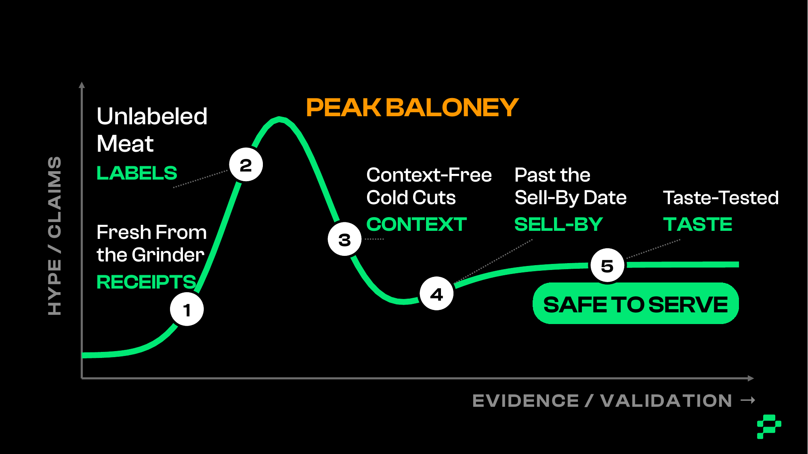
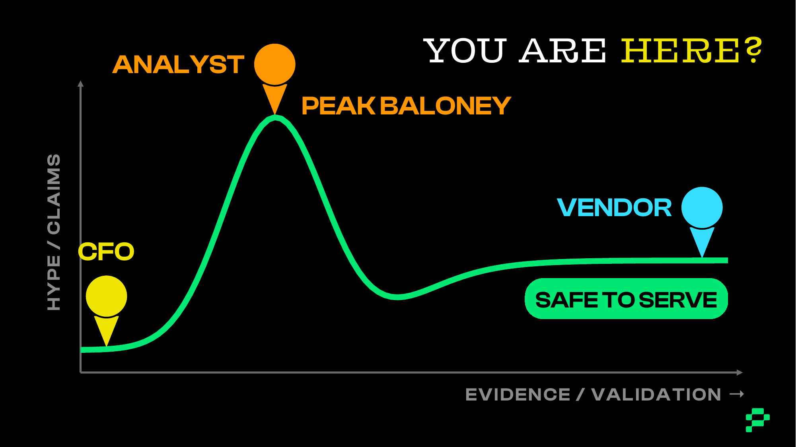

# BALONEY-CURVE.md

# The AI Hype Baloney Curve

There are hype models out there (Gartner's is the famous one) that track **how excited the market is over time**.

This curve tracks something a product person actually needs: **how much of the story has earned our confidence.**

---

## The axes

- **Up the side: HYPE / CLAIMS.** How loudly something is being claimed.
- **Along the bottom: EVIDENCE / VALIDATION.** Not time. How much evidence actually supports it.

The gap between how loud the claim is and how much evidence supports it **is the baloney**.

---

## The shape

A new claim starts low, rockets to **PEAK BALONEY** on enthusiasm alone, drops as reality sets in, then levels off at **SAFE TO SERVE** once it has earned the right to move forward.

---

## Five stops, five checks

Each stop is where one check of the kit does its work.

| Stop | What's happening | Kit check |
|---|---|---|
| **1. Fresh From the Grinder** | New model, agent, startup, benchmark, or keynote claim. Everybody's excited. Nobody knows much yet. | **Show Me the Receipts** |
| **2. Unlabeled Meat** | The claim gets repeated until nobody remembers which parts were fact, inference, or assumption. | **Label the Lunch Meat** |
| **3. Context-Free Cold Cuts** | "AI increased productivity 40%!" For whom? Doing what? Under what conditions? | **Check the Context Pantry** |
| **4. Past the Sell-By Date** | Old benchmarks, pricing, model behavior, regulations, and assumptions still passed around as current truth. | **Check the Sell-By Date** |
| **5. Taste-Tested** | Somebody finally puts it in front of real users and tests whether it's valuable, usable, viable, and feasible. | **Taste Before You Ship** |

---

## Safe to Serve

Safe to Serve is the curve's endpoint, and it is the same thing as **Real Deal** on the [Baloney Scale](BALONEY-SCALE.md).

> **This bet, for these people, solving this problem, under these conditions, has earned the right to move forward.**

Not "AI is good." Not "AI is mature." Not "the technology works."

---

## Curve vs. Scale

- **The Curve is the path.** It shows the stages a claim moves through and which check applies at each.
- **The Scale is the rating.** It says where a claim sits right now, check by check, from Real Deal (baloney level 1) to Total Crapola (baloney level 5).

Use the Curve to explain *why* a claim isn't ready yet, and the Scale to record *how* not-ready it is.

---

## Curve vs. Funnel

- **The Curve is one claim's journey** over time and evidence.
- **The [Baloney Funnel](README.md#the-baloney-funnel) is how you sort a pile of claims.** It runs the same five checks as seven steps, outcome first: Chaos (Outcomes, Receipts) → Confusion (Labels, Sell-By, Relevance) → Crapola (Taste) → Considered (Pivot, Punt, or Pursue) → Truth.
- **Truth out of the Funnel = Safe to Serve on the Curve = Real Deal on the Scale.**

The Funnel checks Sell-By before any test, in the Confusion tier, because a date check is cheap. On the Curve, "Past the Sell-By Date" sits late because that's when stale claims tend to bite. Both are true; they answer different questions. The Funnel also asks one question the Curve doesn't draw: is there a real outcome at all?

**Safe to Serve has a sell-by date.** When a re-check trigger fires (a model version, a price, a policy), a claim that reached Safe to Serve goes back to Fresh From the Grinder. The curve art doesn't show that return arrow yet; it's exported from the keynote decks, so add it there first.

---

## "You are here"

Ask three people where an AI claim sits on the curve and you'll get three pins:

- **The vendor** says it's Safe to Serve.
- **The analyst** says it's at Peak Baloney.
- **Your CFO** asks where the evidence is, because it hasn't left the grinder yet.

Three pins on one curve is what confusion looks like. The kit is how you agree on one pin.

---

## The adopter trap

New to you doesn't mean new. Somebody else may already be early-majority on it. Check the receipts before you call it pioneering.

---

## Further reading

- Cezary Gesikowski, "You've Been Using the Gartner Hype Cycle Wrong," *Towards AI*, April 2026. A good case for treating any hype curve as one input, not a strategy, and pairing it with readiness, governance, and stage-gate evidence.
