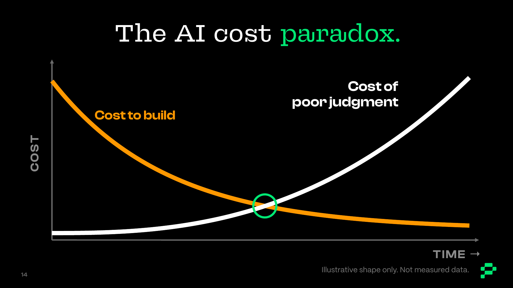

# AI Baloney Detection Kit

> Help an AI claim, idea, or product earn confidence before it lands on a roadmap or in front of customers.

**10 skills: seven funnel skills, one utility, and two quick checks.**

For Product Managers, product leaders, and product teams deciding whether an AI idea deserves investment. The kit checks evidence, assumptions, context, freshness, and validation, then recommends **Pursue, Pivot, or Punt** for a named next step.

**Sort your work, then check your claims.** Use `bdk-skill-sorter` for how you spend your week; use `bdk-detector` for what you're being sold or asked to build.

## Start here

In Claude Code, open this repository as your working folder and try:

```text
/bdk-detector DUMP + BOSS: Assess evals/cases/06-bounded-pilot.md.
Use the supplied fictional evidence only. Show what is supported,
what is missing, and what next investment the evidence has earned.
```

Replace the sample with your own claim, notes, or attached material. The sample is synthetic, not customer evidence.

**Other assistants:** provide [bdk-detector/SKILL.md](skills/bdk-detector/SKILL.md) and its [assessment contract](skills/bdk-detector/references/assessment-contract.md), then paste your material. If commands aren't discovered, ask the assistant to read those files directly.

[Setup and installation routes](INSTRUCTIONS.md#use-the-skills) · [Download all ten skills](dist/ai-bdk-skills.zip) · [More examples](INSTRUCTIONS.md#try-a-complete-assessment)

Plugin manifests and portable ZIPs are included. Assistant-specific installation and discovery have not been verified in this build; see [verification](evals/VERIFICATION.md).

## The skills

Each funnel skill works independently with direct notes or partial context. Start with the decision you need to make; use `bdk-detector` when you want the whole funnel.

### Funnel skills

| Tier | Skill | Use it to | Leaves you with |
|---|---|---|---|
| Whole funnel | [bdk-detector](skills/bdk-detector/SKILL.md) | Assess one claim or a pile of pitches and roadmap items | Stage card; full funnel report on request |
| Chaos | [bdk-receipts](skills/bdk-receipts/SKILL.md) | Trace source support, provenance, and independence | Receipts Ledger |
| Chaos | [bdk-sell-by](skills/bdk-sell-by/SKILL.md) | Check whether evidence is fresh enough for this decision | Freshness Ledger and re-check triggers |
| Confusion | [bdk-labels](skills/bdk-labels/SKILL.md) | Separate fact, inference, assumption, and best guess | Labeled Claims |
| Confusion | [bdk-context-pantry](skills/bdk-context-pantry/SKILL.md) | Find missing customer, workflow, outcome, and economic context | Context Inventory |
| Crapola | [bdk-taste-test](skills/bdk-taste-test/SKILL.md) | Design cheap tests of the riskiest assumptions or review results | Taste Test with thresholds |
| Considered | [bdk-four-risks](skills/bdk-four-risks/SKILL.md) | Decide what investment the evidence has earned | Four-Risk Grid and decision record |

### Utility and quick checks

| Type | Skill | Use it to | Leaves you with |
|---|---|---|---|
| Utility | [bdk-util-slice-the-pitch](skills/bdk-util-slice-the-pitch/SKILL.md) | Extract checkable claims from a deck, demo, release, or roadmap | Claim list ready for the funnel |
| Quick check: claims | [bdk-value-or-theater](skills/bdk-value-or-theater/SKILL.md) | Pressure-test a pitch, initiative, or hot take with five questions | VALUE, THEATER, or NOT YET, plus the next move |
| Quick check: work | [bdk-skill-sorter](skills/bdk-skill-sorter/SKILL.md) | Sort a role, calendar, or weekly work | Busywork / Beige / Theater / Truth grid and Monday actions |

The utility stops at its claim list; it does not automatically run the funnel. Quick checks sit outside the funnel. Escalate a consequential claim from `bdk-value-or-theater` to `bdk-detector`.

See the [full catalog](catalog/INDEX.md) for human decision gates and handoffs to sibling kits, or [SKILLS.md](SKILLS.md) for the architecture.

## The five checks

| Check | Question |
|---|---|
| **Show Me the Receipts** | Where did this come from, and should we trust it? |
| **Label the Lunch Meat** | What is FACT, INFERENCE, ASSUMPTION, or BEST GUESS? |
| **Check the Context Pantry** | Who is this for, what changes for them, and under which constraints? |
| **Check the Sell-By Date** | Is this information fresh enough to make the call? |
| **Taste Before You Ship** | Has reality had a chance to disagree? |

For consequential facts, retrieve the authoritative record. Generated synthesis does not become evidence because it reads well. Five articles repeating one press release are still one source.

## The Baloney Funnel

**Chaos → Confusion → Crapola → Considered → Truth**

The cheapest checks run first, so nobody spends a week testing a claim whose only source is a press release.

| Tier | Question | Checks |
|---|---|---|
| **Chaos** | Is it real, and is it still true? | Show Me the Receipts · Check the Sell-By Date |
| **Confusion** | What do we actually know, and does it apply to us? | Label the Lunch Meat · Check the Context Pantry |
| **Crapola** | Would reality disagree? | Taste Before You Ship |
| **Considered** | Pursue, pivot, or punt? | The four risks |
| **Truth** | What has earned the next investment? | A scoped decision with a re-check date |

Each tier has four exits: **Pass**, **Sifted out**, **Send back** for missing or stale evidence, or **Pivot** and re-enter at that tier. Missing is not failed. Stale is not false. When evidence expires, the claim returns to the top.

### The four risks

| | **For them** | **For us** |
|---|---|---|
| **Should we?** | **Valuable:** "Is this something someone would buy?" | **Viable:** "Is this good business?" (Is there ROI for both sides?) |
| **Can we?** | **Usable:** "Will users trust and adopt it?" | **Feasible:** "Can we even do this with what we know and have?" |

Test the riskiest open square first. A working demo answers only part of Feasible. *The four risks come from Marty Cagan (SVPG); the questions are ours.*

**Safe to Serve** means: “This bet, for these people, solving this problem, under these conditions, has earned the right to move forward.” Humans own that decision; the next step may be another experiment, a pilot, or a clear “not yet.”

## The Baloney Scale

| Level | Rating | Translation |
|---|---|---|
| 1 | **Real Deal** | Slice it up. Put it on a hoagie. Good to go. |
| 2 | **Mostly Meat** | Probably edible. Pick out the pimentos. |
| 3 | **Real Imitation Baloney** | Looks real. Still junk food. |
| 4 | **Mystery Meat** | Nobody knows exactly what went into this. |
| 5 | **Total Crapola** | Put it in the garden. It's fertilizer now. |

Show **where the baloney entered the system**, not just a score. A claim can have strong receipts and weak validation. See [the scale](BALONEY-SCALE.md) for interpretation and [the AI Hype Baloney Curve](BALONEY-CURVE.md) for one claim's path from Peak Baloney to Safe to Serve.

## Pick a mode and voice

| Mode | Best for | Kickoff |
|---|---|---|
| **Guided Discovery** | Fuzzy ideas, workshops, or learning the method | `GUIDED: Walk me through it.` |
| **Context Dump** | Research, notes, transcripts, metrics, or a PRD | `DUMP: Here's the mess. Sort it out.` |
| **Spitballing** | Early exploration and conversational pressure-testing | `SPITBALL: Kick this around with me.` |

**Product Coach** is the default voice. Choose **Comedian**, **Pirate**, **Boss**, or **Antagonist** to change the presentation. Evidence rules stay the same. See [MODES.md](MODES.md) and [VOICES.md](VOICES.md).

## Why this kit exists



AI makes it easier to build the wrong thing faster. This kit helps assess **Chaos initiation** (new workflow and operational mess), **Confusion induction** (unclear outcomes, evidence, or ownership), and **Crapola instantiation** (certainty the evidence hasn't earned).

Progress means uncertainty reduced and outcomes improved. *The chart is illustrative, not measured data.*

## Saw it at ProductFest 2026?

This is the companion kit for Dean Peters' keynote, **“Getting Past the AI Chaos, Confusion, and Crapola.”** Try [a 12-item AI roadmap](evals/loop-cases/loop-09-roadmap-funnel.yaml) with `bdk-detector`, [a theater pitch](examples/pitch-theater.md) with `bdk-value-or-theater`, or [a fictional job description](examples/jd-senior-pm.md) with `bdk-skill-sorter`.

The [Curve](BALONEY-CURVE.md), [Funnel](#the-baloney-funnel), [four-risk grid](#the-four-risks), and [PM Code](CONSTITUTION.md#the-pm-code-the-stage-edition) are here to take home.

## Maintain and verify

Run the existing structural and local-link checks:

```bash
python3 scripts/check-library.py
```

Requires Python 3 and PyYAML. See [the maintenance handoff](docs/HANDOFF.md) for dependencies and distribution builds. These are mechanical checks; [synthetic assessments](evals/README.md) and [the verification record](evals/VERIFICATION.md) show the limits of behavioral and human-use evidence.

The README provides context, [AGENTS.md](AGENTS.md) sets the collaborator contract, and [CONSTITUTION.md](CONSTITUTION.md) defines the principles. Captures preserve sources, evidence labels, uncertainty, validation, and decisions. For authoring and history, see [the skill spec](docs/SKILL-SPEC.md), [provenance](docs/PROVENANCE.md), and [update log](docs/UPDATE-LOG.md).

## License

Everything in this repository—skills, examples, and docs—uses [CC BY-NC-SA 4.0](LICENSE).

- **Use it in your day job**, with your team and in your agents.
- **Adapt and share it** under the same license, with credit.
- **Teach with it** in workshops, brown bags, and mentoring.
- **Don't repackage the kit into a paid product, course, or service** without express written permission.
- Unsure about your use? Open an issue and ask.

The two quick checks were adapted from Dean's ProductFest keynote demos; see [provenance](docs/PROVENANCE.md).
